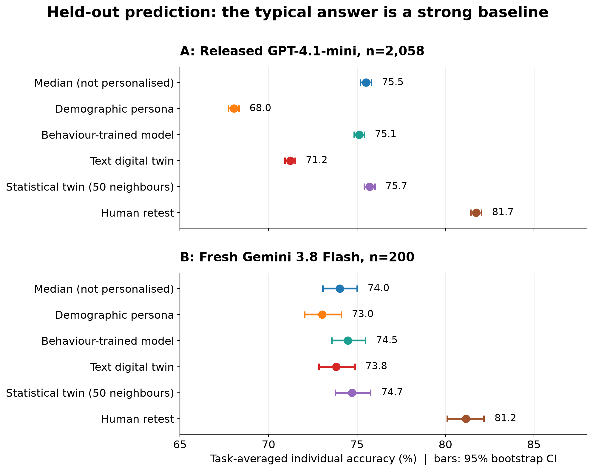
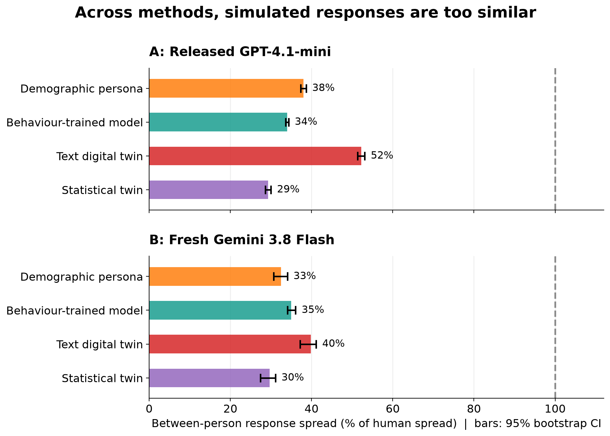

# simulated-crowds-eval

Code, model outputs and results for the working paper *When the Average Looks Right: Evaluating Behavioural Fidelity in Synthetic Consumers* (Puneet Bajaj, 2026).

A model can score well on survey prediction by giving everyone the usual answer. This repository measures how much more synthetic consumers learn about each person, using the 2,058 real respondents of [Twin-2K-500](https://huggingface.co/datasets/LLM-Digital-Twin/Twin-2K-500).

## What is compared

| Approach | What it knows about the person |
|---|---|
| Median baseline | Nothing: everyone gets the median answer of people in other cross-validation folds |
| Demographic persona (LLM) | Demographics |
| Text digital twin (LLM) | A text profile built from the person's earlier answers, with the target answers removed |
| Behaviour-trained model | The person's earlier answers (gradient-boosted trees, one per question) |
| Statistical twin | The median answer of the 50 most similar respondents |
| Human retest | The same person answering the same questions again later |

- **Panel A** re-scores the dataset authors' released GPT-4.1-mini predictions for all 2,058 people.
- **Panel B** uses fresh Gemini 3.8 Flash runs on 200 people, three samples per condition. The raw replies are in [results/replies/](results/replies/).
- **New questions** uses the authors' follow-up mega-study: 159 closed-ended outcomes in 18 studies, 1,784 of the same people, with the authors' released GPT-4.1 predictions.

Accuracy gives partial credit for close numeric answers, so a uniformly random answer scores about 59%. Intervals are 95% bootstrap intervals over people (2,000 resamples).

## Results

**Prediction accuracy (%)**

| Approach | Panel A | Panel B |
|---|---|---|
| Median baseline | 75.5 | 74.0 |
| Demographic persona | 68.0 | 73.0 |
| Text digital twin | 71.2 | 73.8 |
| Behaviour-trained model | 75.1 | 74.5 |
| Statistical twin | 75.7 | 74.7 |
| Human retest | 81.7 | 81.2 |



**Between-person spread (% of the human spread)**

| Approach | Panel A | Panel B |
|---|---|---|
| Demographic persona | 38 | 33 |
| Text digital twin | 52 | 40 |
| Behaviour-trained model | 34 | 35 |
| Statistical twin | 29 | 30 |



**New questions (accuracy %, each study weighted equally; a random answer scores 61.7%)**

| Approach | Accuracy | Difference from the median, points |
|---|---|---|
| LLM with no profile | 71.9 | −4.1 (−4.5 to −3.7) |
| Demographic persona | 73.5 | −2.5 (−2.8 to −2.2) |
| Text digital twin | 73.9 | −2.1 (−2.4 to −1.7) |
| Median baseline | 76.0 | — |
| Behaviour-trained model | 76.3 | +0.3 (−0.0 to +0.6) |
| Statistical twin | 76.4 | +0.4 (+0.3 to +0.5) |

The median baseline, behaviour-trained model and statistical twin learn from other people's answers to each question; the LLM approaches do not. The comparison shows what each configuration achieves with the evidence it was given, not which architecture is best.

Full tables:

- [Panel A](results/panel_a.md) and [Panel B](results/panel_b.md): accuracy, spread, distribution distance and experimental effects
- [Statistical twin](results/exploratory/statistical_twin_panels.md) added to both panels
- [Exploratory analyses](results/exploratory/core.md): chance and prior corrections, rank agreement, memory versus generalisation
- [Personal price model](results/exploratory/personal_price.md): the 40 pricing decisions
- [New questions](results/generalization/generalization.md): the mega-study

Everything except the two panels' main comparison is exploratory.

## Reproduce

Requires [uv](https://docs.astral.sh/uv/) and about 2 GB of disk for the downloaded data.

```sh
uv sync
uv run python -m crowdeval.reproduce
```

This runs every step in order and rewrites `results/`. It calls no model API: Panel B is scored from the published replies. The data downloads from Hugging Face at the revisions pinned in [`src/crowdeval/config.py`](src/crowdeval/config.py). Independent steps run side by side; most of the time goes on training the behaviour models, about 10 minutes on 12 cores.

| Step | Writes |
|---|---|
| `crowdeval.steps.run_panel_a` | `results/panel_a.*` |
| `crowdeval.steps.run_panel_b` | `results/panel_b.*` |
| `crowdeval.steps.run_exploratory` | `results/exploratory/core*` |
| `crowdeval.steps.run_statistical_twin` | `results/exploratory/statistical_twin_*` |
| `crowdeval.steps.run_individual` | `results/exploratory/personal_price.*` |
| `crowdeval.steps.run_generalization` | `results/generalization/` |
| `crowdeval.steps.figures` | `results/figures/` |

Each step can also be run on its own with `uv run python -m <step>`. Tests: `uv run pytest`.

Before computing any new-question result, `steps.run_generalization` checks that its scoring reproduces the dataset authors' published per-outcome accuracies for the mega-study, and stops if it does not.

### Running the Gemini calls again (optional)

Panel B's replies can be regenerated with your own key. This costs money and, because the model samples at temperature 1.0, gives close but not identical replies.

```sh
export GEMINI_API_KEY=...
uv run python -m crowdeval.llm.gemini_run --name main --people 200 --samples 3
```

Replies go to `data/runs/replies_main.jsonl`, and `steps.run_panel_b` uses them instead of the published file when present. `--conditions` selects the no-profile, memory-control and ID-only runs.

## Layout

```
src/crowdeval/
  steps/           one module per step above, plus the figures
  core/            accuracy scoring, population metrics, bootstrap panels, effects, rank agreement
  models/          median baseline, behaviour-trained model, statistical twin, personal price model
  llm/             persona and twin prompts, reply parsing, the Gemini runner
  new_questions/   the mega-study: outcomes, conditions, leak guard, check against the authors, scoring
  upstream/        prompt and answer handling ported from the dataset authors' code
  config.py        dataset revisions, paths, seeds
  data.py          download and load Twin-2K-500
  reproduce.py     runs every step
results/           every table and figure, plus the published Gemini replies
tests/             unit and data-backed tests
```

## Credits and licences

- Code in this repository: MIT License.
- Twin-2K-500: Toubia, O., Gui, G. Z., Peng, T., Merlau, D. J., Li, A., & Chen, H. (2025). Database Report: Twin-2K-500: A data set for building digital twins of over 2,000 people based on their answers to over 500 questions. *Marketing Science*, 44(6), 1446–1455. [doi:10.1287/mksc.2025.0262](https://doi.org/10.1287/mksc.2025.0262). CC BY 4.0, downloaded at run time and not redistributed here.
- Twin-2K-500 Mega-Study: Peng, T., Brucks, M., Gui, G., et al. (2026). Digital twins are funhouse mirrors: Five systematic distortions. *Science Advances*, 12(36), eaeh8260. [doi:10.1126/sciadv.aeh8260](https://doi.org/10.1126/sciadv.aeh8260). Apache-2.0, downloaded at run time.
- Column ranges, task mapping, prompt and response handling, the mega-study outcome ranges and condition definitions are ported from the authors' repositories under Apache-2.0. See [NOTICE](NOTICE).
- The Gemini replies in `results/replies/` are released under CC BY 4.0.
